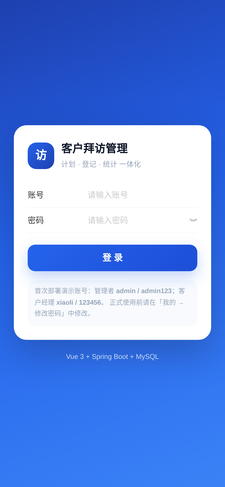
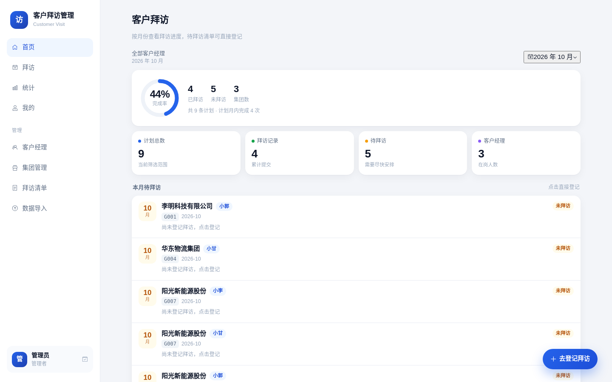
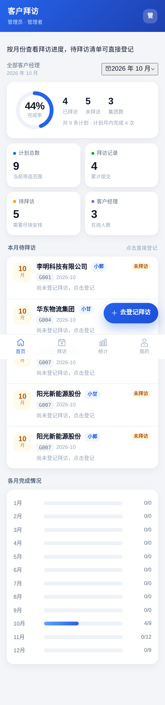
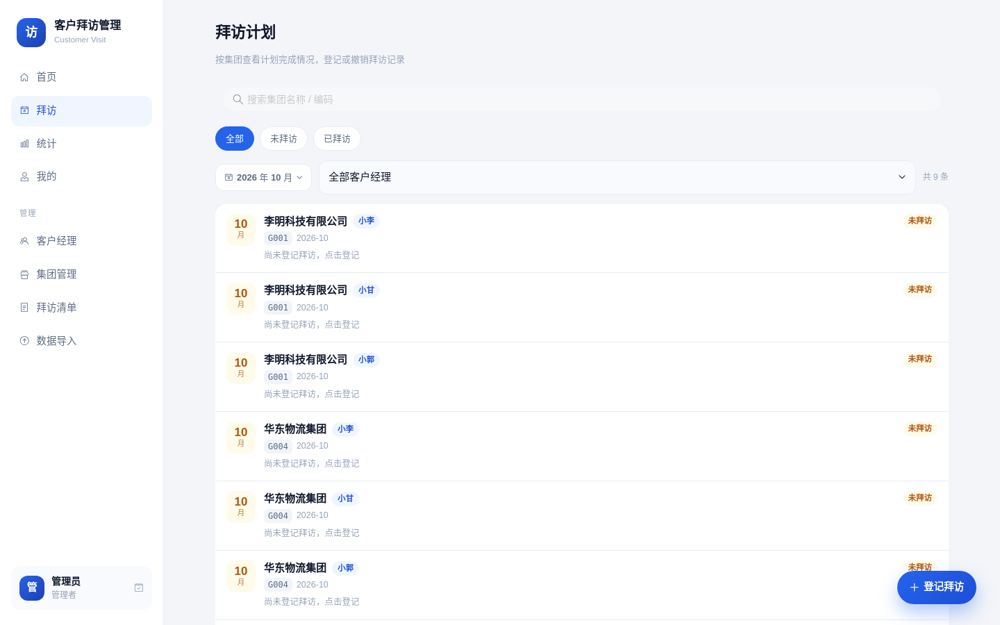
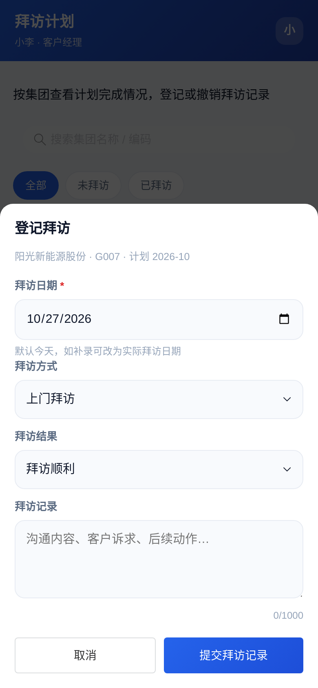

# 客户拜访管理系统

Vue 3 + Spring Boot 3 + MySQL 8 的前后端分离实现。

本仓库早期版本是单文件网页 `拜访管理小程序-实时汇总版.txt`（角色切换 + localStorage + 可选 Supabase 同步），
现已重构为前后端分离项目；老文件保留在仓库根目录，便于对照历史版本。

保留原有全部业务能力（客户经理/管理者视角、拜访计划、登记/撤销、统计、Excel 导入导出），
并针对手机使用、多人协作和数据安全做了系统性改进。

---

## 1. 功能一览

**客户经理（手机端为主）**
- 登录后只看自己的拜访计划；首页看完成率、待拜访清单、各月进度
- 拜访页：搜索、按状态/月份筛选、点卡片看详情
- 登记拜访：日期 / 方式 / 结果 / 记录，一条计划一条记录，可修改、可撤销
- 统计页：完成率、计划月内完成、月度进度、集团覆盖
- 我的：改密码、导出本人拜访记录（Excel 直接下载到手机）

**管理者（管理员账号）**
- 全量视图：所有客户经理的进度、对比、集团覆盖
- 客户经理账号管理：新增、停用/启用、重置密码、删除（级联清理计划与记录）
- 集团主数据管理：编码唯一、名称统一，避免同码异名
- 拜访清单管理：按「客户经理 + 集团 + 月份」新增/修改/删除
- Excel 导入：按 Sheet 批量导入计划，先预览校验（警告/去重/自动建账号），再合并或按范围替换
- Excel 导出：拜访记录（明细 + 按集团汇总）、完整清单（可再导入的清单 + 拜访明细）
- 修改自己的密码

## 2. 相对原版的改进

| # | 原版（单文件网页） | 新版 | 为什么更合理 |
|---|---|---|---|
| 1 | 用下拉框「切换身份」，管理者密码存 localStorage（默认 123456），任何人可切换 | 真实账号 + JWT 登录，ADMIN / MANAGER 权限由后端校验 | 身份不可伪造，权限边界清晰 |
| 2 | 数据存浏览器 localStorage，换设备看不到；云端方案把整份 JSON 存一行，后写覆盖先写 | MySQL 单一数据源 + 事务 + 唯一约束 | 多人同时登记不互相覆盖，换手机也一致 |
| 3 | 集团名称/编码在多条计划里重复存，改名要逐条改，容易同码异名 | 集团主数据表 + 计划引用 | 一处维护，全局一致 |
| 4 | 月份写死「十月/十一月/十二月」，跨年就乱 | `plan_month` 存 `YYYY-MM`，任意年月 | 支持跨年、跨季度 |
| 5 | 拜访记录与计划靠字符串 id 关联，重名/改码可能丢关联 | 数据库外键 + `plan_id` 唯一约束 | 结构上保证一条计划最多一条记录 |
| 6 | 一次性渲染全部卡片，数据多会卡 | 后端分页 + 前端无限滚动 + 搜索/筛选 | 手机滚动流畅 |
| 7 | 管理功能（导入/清单/绑定）散落在「我的」弹层里，逐条弹窗 | 独立管理页 + 底部抽屉表单 | 手机上点按更稳，操作路径更短 |
| 8 | Excel 解析在浏览器里做（内嵌 1.2MB xlsx 库），导入前看不到校验结果 | 后端 POI 解析，导入前返回预览、警告、去重结果 | 首屏更轻，导入可控可回滚 |
| 9 | 导出用浏览器生成两个文件 | 后端生成 xlsx，手机浏览器直接下载 | 手机也能导出，格式统一 |
| 10 | 无操作留痕、无密码强度要求 | BCrypt 存密码、改密校验、管理员重置密码 | 基础账号安全 |
| 11 | 仅适配 520px 手机宽度 | 移动优先 + 桌面侧边栏自适应（≥900px） | 手机/平板/电脑都能用 |

## 3. 界面预览

| 手机端 | 桌面端 |
|---|---|
|  |  |
|  |  |
|  | |
|  | |

更多截图见 `docs/screenshots/`（统计、我的、导入、详情）。

## 4. 技术栈

- 前端：Vue 3（`<script setup>`）、Vite 5、Vue Router 4、Pinia 2、Vant 4、Axios
- 后端：Spring Boot 3.2、Spring JDBC（JdbcTemplate）、Bean Validation、JJWT、Apache POI、BCrypt
- 数据库：MySQL 8.0（utf8mb4）
- 部署：Docker Compose（MySQL + 后端 + Nginx 静态站点）

## 5. 目录结构

```
├── backend/                 # Spring Boot 服务
│   ├── db/schema.sql        # 建库建表（首次启动自动初始化演示数据）
│   ├── src/main/java/com/example/visit/
│   │   ├── common/          # 统一响应、分页、异常、月份工具
│   │   ├── config/          # CORS/拦截器注册、首启初始化
│   │   ├── security/        # JWT、登录上下文、@AdminOnly
│   │   ├── repo/            # JdbcTemplate 数据访问
│   │   ├── service/         # 业务与权限校验、Excel
│   │   ├── controller/      # REST 接口
│   │   └── dto/             # 请求/响应 record
│   └── Dockerfile
├── frontend/                # Vue 3 单页应用
│   ├── src/
│   │   ├── api/             # axios 封装 + 各模块接口
│   │   ├── components/       # 月份选择、进度环、计划卡片、拜访表单等
│   │   ├── views/            # 登录/首页/拜访/统计/我的
│   │   │   └── admin/        # 客户经理/集团/清单/导入
│   │   ├── router/ stores/ styles/ utils/
│   └── Dockerfile, nginx.conf
├── deploy/docker-compose.yml
├── docs/                    # API、数据库设计、功能对照、部署记录、截图
└── 拜访管理小程序-实时汇总版.txt   # 重构前的单文件版本（历史留存）
```

## 6. 快速开始

### 6.1 Docker 一键启动（推荐）

```bash
cd deploy
cp .env.example .env          # 修改数据库密码、JWT secret
docker compose up -d --build
# 打开 http://服务器IP:8088
```

首次启动会自动建表，并创建默认账号与演示数据（见 6.3）。
查看日志：`docker compose logs -f backend`。

### 6.2 本地开发

```bash
# 1) 数据库：创建库并导入表结构
mysql -uroot -p < backend/db/schema.sql

# 2) 后端（JDK 17+，默认连 localhost:3306/customer_visit）
cd backend
DB_USER=root DB_PASSWORD=你的密码 mvn spring-boot:run

# 3) 前端（Node 18+）
cd frontend
npm install
npm run dev        # http://localhost:5173，/api 自动代理到 8080
```

### 6.3 默认账号（仅演示数据）

| 角色 | 账号 | 密码 |
|---|---|---|
| 管理者 | `admin` | `admin123` |
| 客户经理 | `xiaoli` / `xiaogan` / `xiaoguo` | `123456` |

> 登录后请立刻修改密码；正式环境可用 `INIT_DEMO=false` 只创建 admin 账号，不建演示数据。

### 6.4 配置项（环境变量）

| 变量 | 默认 | 说明 |
|---|---|---|
| `DB_HOST` / `DB_PORT` / `DB_NAME` | localhost / 3306 / customer_visit | MySQL 连接 |
| `DB_USER` / `DB_PASSWORD` | root / 空 | 数据库账号 |
| `SERVER_PORT` | 8080 | 后端端口 |
| `JWT_SECRET` | 内置默认值 | **生产必须替换**，至少 32 字节 |
| `JWT_EXPIRE_HOURS` | 168 | 登录有效期（小时） |
| `CORS_ORIGINS` | `*` | 允许的前端来源，逗号分隔 |
| `INIT_DEMO` | true | 首次启动是否创建演示数据 |
| `DEFAULT_MANAGER_PASSWORD` | 123456 | Excel 导入自动建账号的初始密码 |

## 7. Excel 导入格式

- 每个 **Sheet 名称 = 客户经理姓名**（如「小李」）
- 表头需包含：`集团编码`、`集团名称`，以及月份列，列名支持 `2026-10` / `2026/10` / `2026年10月` / `十月` / `10月`
- 月份列有内容（`是`、`✓`、日期…）即代表该月有拜访计划
- CSV 也支持，但需额外提供 `客户经理` 列（CSV 没有 Sheet 概念）
- 导入流程：上传 → **预览**（条数、涉及经理/月份、警告）→ 选「增量合并」或「按范围替换」→ 写入 → 返回新增/跳过条数与自动创建的账号

「按范围替换」只会删除「本次导入涉及的客户经理 + 月份」范围内的计划及其拜访记录，不会清空全库。

## 8. 权限矩阵

| 能力 | 客户经理 | 管理者 |
|---|---|---|
| 查看/登记/修改/撤销自己的拜访 | ✅ | ✅（可代登记） |
| 查看他人数据 | ❌ | ✅ |
| 导出本人记录 | ✅ | ✅ |
| 导出全部/按经理导出 | ❌ | ✅ |
| 客户经理/集团/清单维护 | ❌ | ✅ |
| Excel 导入 | ❌ | ✅ |

## 9. 移动端适配

- 底部四栏导航 + 顶部渐变状态栏（`safe-area-inset` 适配刘海屏）
- 表单用底部抽屉（`van-popup`），日期用系统原生选择器，点按区域 ≥44px
- 列表无限滚动 + 下拉刷新，搜索框防抖
- 桌面端（≥900px）自动切换为左侧固定菜单 + 宽内容区 + 四列统计卡
- 手机浏览器可直接把站点「添加到主屏幕」，体验接近 App

## 10. 接口与数据库文档

- 接口清单：[docs/API.md](docs/API.md)
- 表结构与设计取舍：[docs/数据库设计.md](docs/数据库设计.md)
- 原版功能逐项对照：[docs/功能对照表.md](docs/功能对照表.md)
- 云服务器 9090 预览环境部署与启停：[docs/部署记录.md](docs/部署记录.md)

## 11. 验证记录（2026-10-27）

- `mvn -DskipTests package`：BUILD SUCCESS（JDK 17）
- `npm run build`：构建成功（gzip 主包约 146 KB）
- 接口冒烟（临时 MySQL 库，测完已删除、服务已停）：
  - 登录/鉴权：admin、xiaoli 正常；错误密码 401；无 token 401；客户经理访问管理接口 403
  - 计划：分页、按月/状态/关键字筛选、重复分配 409、非法月份 400
  - 拜访：登记、重复登记 409、修改、撤销、跨账号操作 403
  - 统计：overview / by-manager / by-month（补 12 个月）/ by-group
  - Excel：模板、拜访记录导出、完整清单导出、xlsx/csv 预览、合并导入、按范围替换、自动建账号、集团名称冲突提示
  - 级联：删除集团后其计划与拜访记录归零
- 前端 UI 冒烟（Chromium 无头，390×844 + 1440×900）：登录 → 首页 → 拜访 → 统计 → 我的 → 导入页全部正常渲染；
  手机端无横向溢出；拜访登记/撤销、详情抽屉、管理员越权跳转均符合预期；截图见 `docs/screenshots/`
- 未在云服务器常驻部署（按约定由你本机/内网验证）

## 12. 后续可扩展

- 拜访提醒（企业微信/短信/公众号模板消息）
- 拜访照片附件、定位签到
- 计划变更审计日志
- 按季度/区域的多维统计
- 单点登录（对接企业账号）
